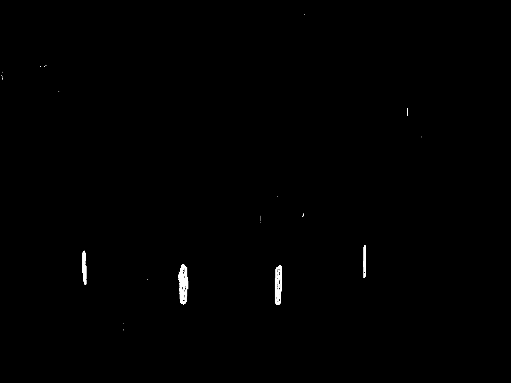
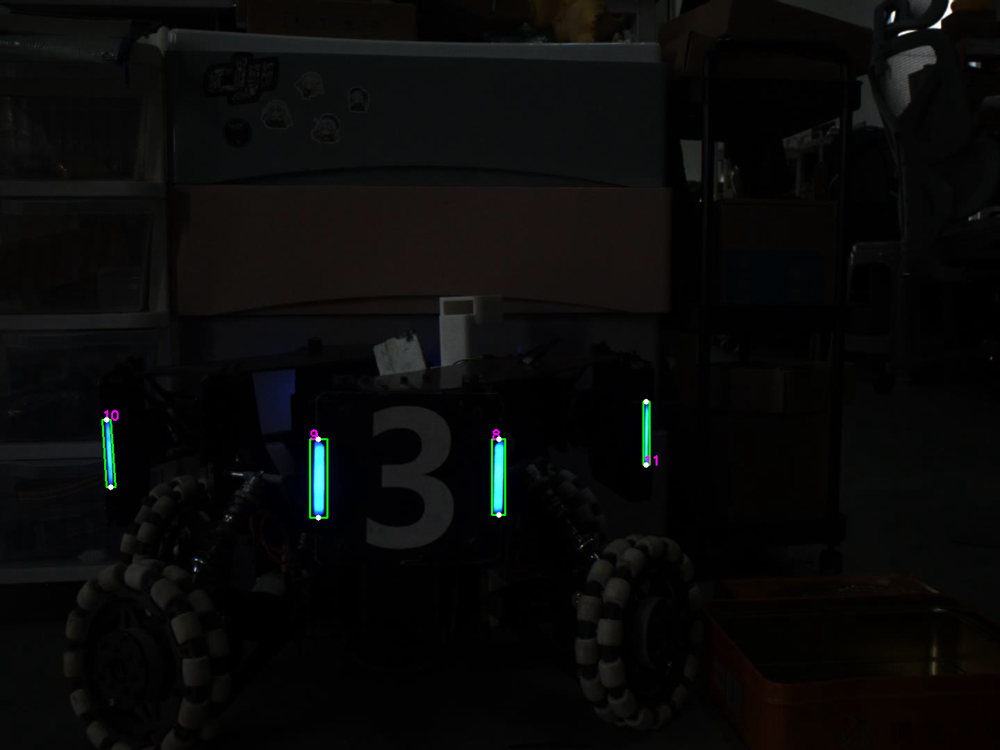
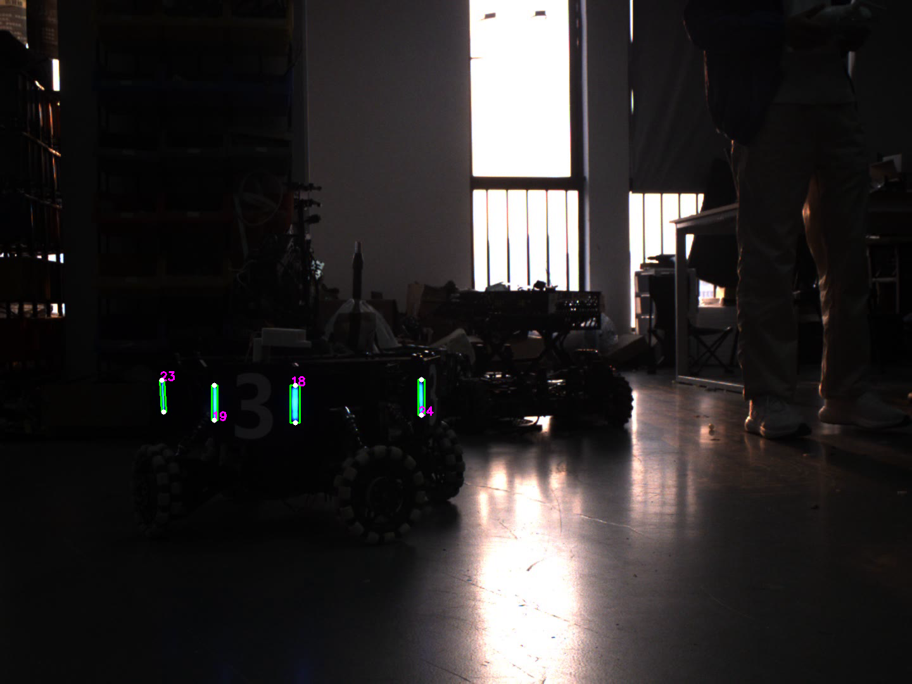
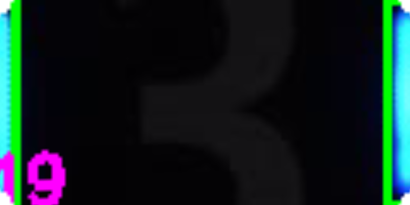
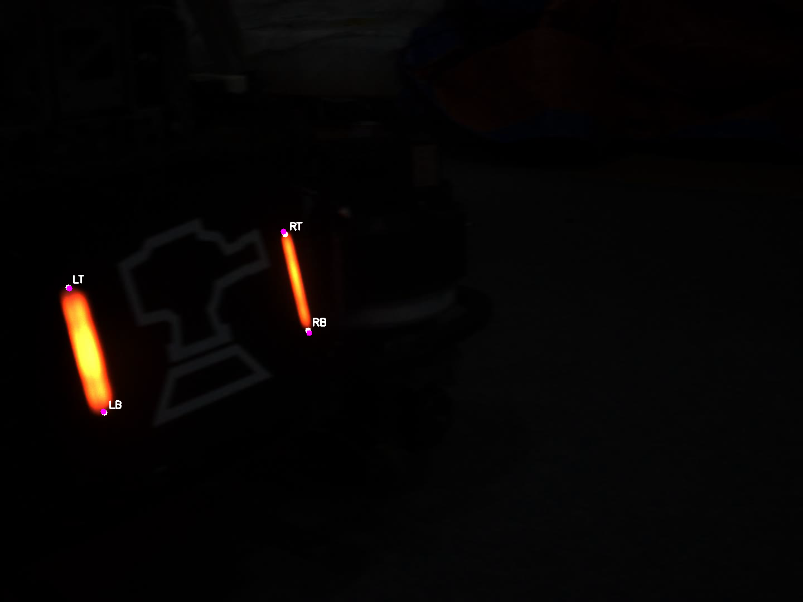

# OpenCV 学习笔记与代码手册

> 以当前练习代码为索引，记录 OpenCV 图像处理、目标检测、几何视觉和视频跟踪的常用接口。源码保持可查，文档解释每个练习中的主要接口、输入输出、原理、常见问题，并用实际运行结果配图。

## 学习内容

1. [图像、Mat、ROI 与窗口](docs/01-image-and-mat.md)
2. [颜色空间、阈值与形态学](docs/02-color-and-morphology.md)
3. [轮廓、旋转矩形与灯条筛选](docs/03-contours-and-bars.md)
4. [灯条配对与透视变换](docs/04-pairing-and-perspective.md)
5. [PnP 位姿估计与重投影误差](docs/05-pnp.md)
6. [视频读写与目标关联](docs/06-video-and-tracking.md)
7. [卡尔曼滤波目标跟踪](docs/07-kalman-filter.md)
8. [替换运动模型与过程噪声](docs/08-kalman-models.md)：随机游走、两种匀速噪声和匀加速白 jerk 模型。
9. [HSV 色彩范围指示器](docs/09-hsv-range-visualizer.md)：静态图示和可调节的 OpenCV 滑块工具。
10. [源码索引](SOURCE_INDEX.md)

## 环境与编译

- C++17
- CMake 3.16+
- OpenCV 4.x（需要 `core`、`imgproc`、`imgcodecs`、`highgui`、`videoio`、`calib3d`）

```bash
cmake -S . -B build
cmake --build build -j
```

程序使用相对路径读写 `image/` 与 `image_output/`。为保持原代码路径可用，从 `build/` 目录启动可执行文件：

```bash
cd build
../target/task_01
```

依次可运行 `task_02` 到 `task_07`、`image_base`。`task_06` 和 `task_07` 需要对应的 AVI 输入视频；`cap_video` 需要 `video/031.mp4`。这些较大的原始视频不放入本仓库，需把自己的样例视频放到代码指定位置。图片任务所需的小型示例图和 Task 05 相机参数文件随仓库提供。

## 仓库目录

```text
src/                 原始练习程序和各目标的 CMakeLists.txt
include/             灯条检测、关联、透视变换与可切换卡尔曼模型
image/               代码引用的小型输入图片及 PnP 标定数据
assets/figures/      文档使用的处理结果图
image_output/        运行时结果目录；已提交少量 PNG 作为学习示例
build/, target/      本地构建产物，不提交
```

## 示例结果

### 颜色掩模与形态学



### 轮廓与候选灯条筛选



### 灯条配对和俯视展开




### PnP 重投影



## 关于代码

本仓库记录的是学习过程中的实现。阈值、几何条件和卡尔曼噪声参数是针对当前样例调出的经验值，不是适用于所有相机或目标的通用参数。复杂算法的推导和适用前提见相应专题。运行前请检查数据文件路径、相机标定参数和视频是否匹配。
