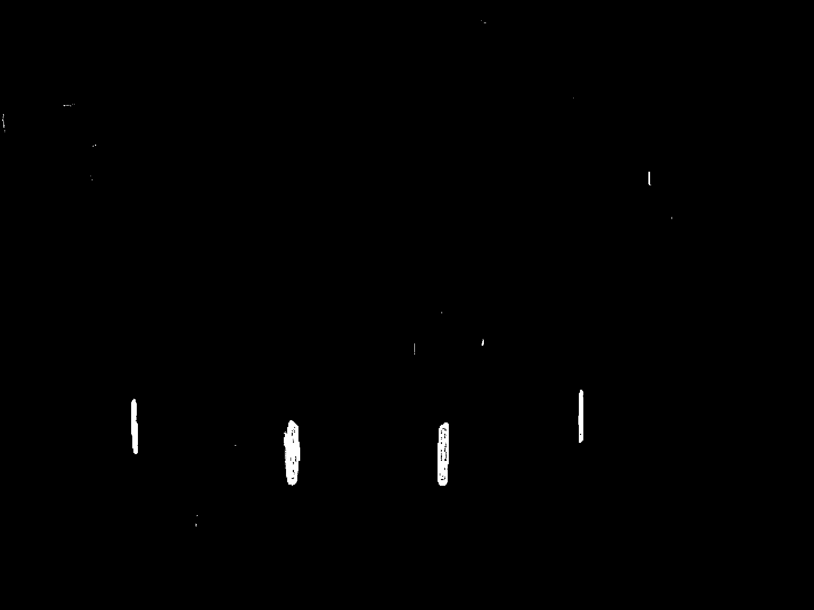
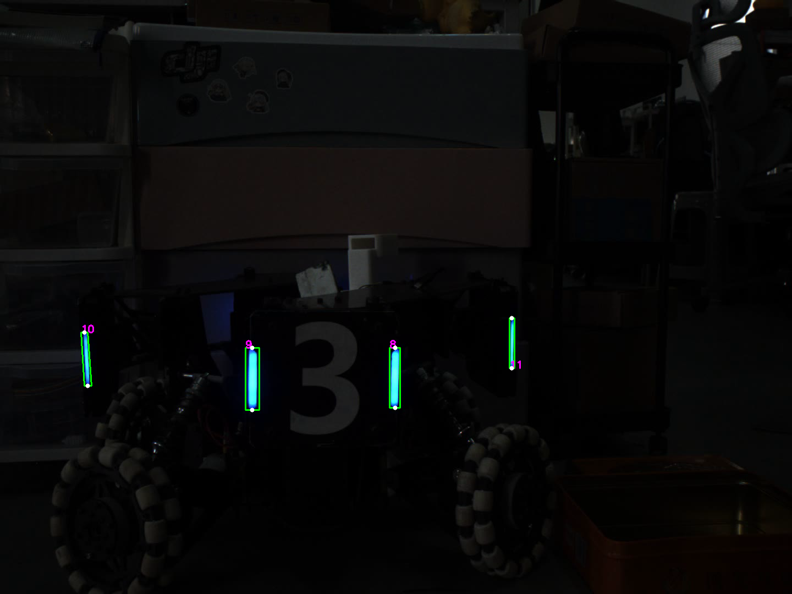
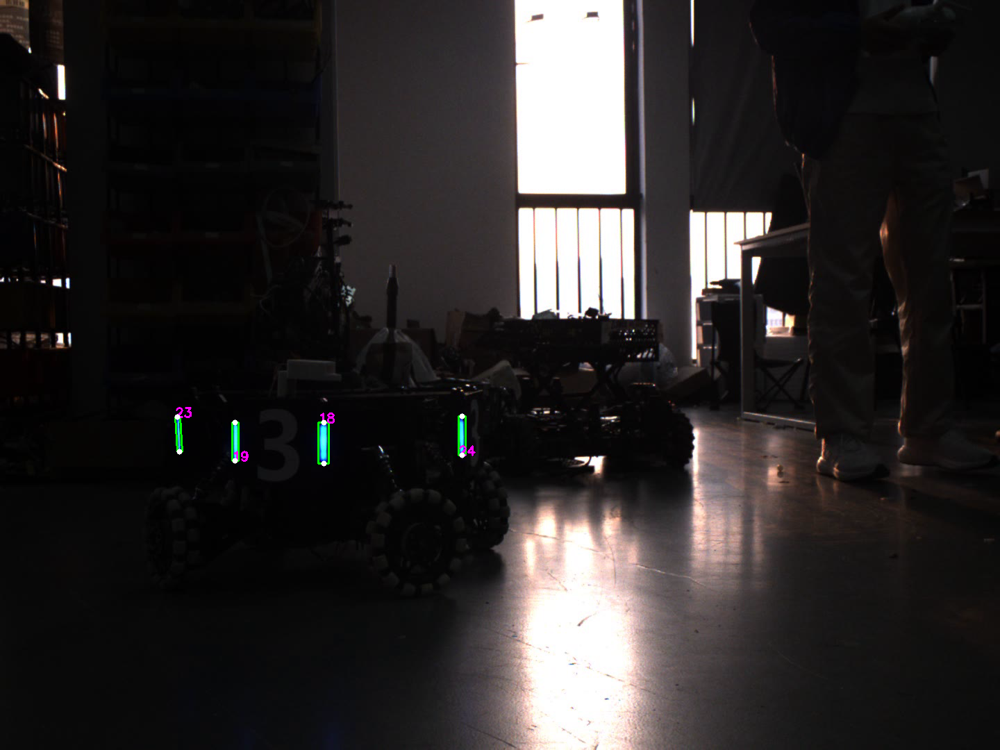
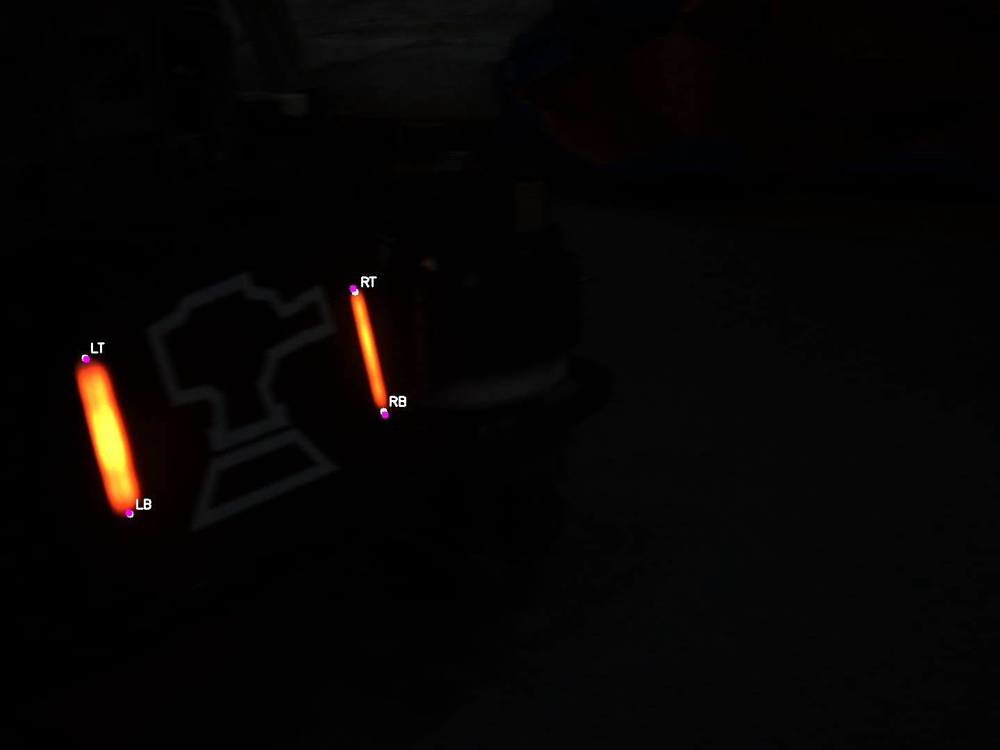

# OpenCV 学习笔记与代码手册

> 以当前练习代码为索引，记录 OpenCV 图像处理、目标检测、几何视觉和视频跟踪的常用接口。源码保持可查，文档解释每个练习中的主要接口、输入输出、原理、常见问题，并用实际运行结果配图。

## 学习内容

1. [图像、Mat、ROI 与窗口](docs/01-image-and-mat.md)
2. [颜色空间、阈值与形态学](docs/02-color-and-morphology.md)
3. [轮廓、旋转矩形与灯条筛选](docs/03-contours-and-bars.md)
4. [灯条配对与透视变换](docs/04-pairing-and-perspective.md)
5. [PnP 位姿估计与重投影误差](docs/05-pnp.md)
6. [视频读写与目标关联](docs/06-video-and-tracking.md)
7. [卡尔曼滤波目标跟踪](docs/07-kalman-filter.md)：Task 07 线性 KF；KF/EKF 对比、完整调用和改造步骤见本 README 下文。
8. [替换运动模型与过程噪声](docs/08-kalman-models.md)：随机游走、匀速/匀加速及协调转弯、变速转弯 EKF。
9. [HSV 色彩范围指示器](docs/09-hsv-range-visualizer.md)：静态图示和可调节的 OpenCV 滑块工具。
10. [源码索引](SOURCE_INDEX.md)

## 环境与编译

- C++17
- CMake 3.16+
- OpenCV 4.x（需要 `core`、`imgproc`、`imgcodecs`、`highgui`、`videoio`、`calib3d`）

```bash
cmake -S . -B build
cmake --build build -j
```

程序使用相对路径读写 `image/` 与 `image_output/`。为保持原代码路径可用，从 `build/` 目录启动可执行文件：

```bash
cd build
../target/task_01
```

依次可运行 `task_02` 到 `task_07`、`image_base`。`task_06` 和 `task_07` 需要对应的 AVI 输入视频；`cap_video` 需要 `video/031.mp4`。这些较大的原始视频不放入本仓库，需把自己的样例视频放到代码指定位置。图片任务所需的小型示例图和 Task 05 相机参数文件随仓库提供。

## 仓库目录

```text
src/                 原始练习程序和各目标的 CMakeLists.txt
include/             灯条检测、关联、透视变换与可切换卡尔曼模型
image/               代码引用的小型输入图片及 PnP 标定数据
assets/figures/      文档使用的处理结果图
image_output/        运行时结果目录；已提交少量 PNG 作为学习示例
build/, target/      本地构建产物，不提交
```

## 示例结果

### 颜色掩模与形态学



### 轮廓与候选灯条筛选



### 灯条配对和俯视展开




### PnP 重投影



## 卡尔曼滤波 KF 与扩展卡尔曼滤波 EKF

本项目原来的 Task 07 使用**线性 KF 匀速模型**；新增的圆周/协调转弯模型是**EKF**。两者都用 `cv::KalmanFilter` 保存状态、协方差和观测噪声，也都按“预测 → 有测量时校正”的顺序处理每一帧。差别在于 EKF 的运动方程是非线性的，必须在当前状态附近计算雅可比矩阵，并将非线性预测结果写入 OpenCV 的先验矩阵。

OpenCV 文档说明 `KalmanFilter` 提供 `predict()`、`correct()` 和 `transitionMatrix` 等接口，并允许通过矩阵实现扩展卡尔曼功能；本项目的 EKF helper 会手动算非线性状态预测和雅可比，再调用 OpenCV 的 `correct()`。[OpenCV `cv::KalmanFilter` 参考](https://docs.opencv.org/4.x/dd/d6a/classcv_1_1KalmanFilter.html)

### KF 与 EKF 的差异和共同点

| 项目 | Task 07 线性 KF | 本项目协调转弯 EKF |
|---|---|---|
| 状态 | `[x,y,vx,vy]` | `[x,y,vx,vy,ω]`，`ω` 是转弯角速度 |
| 运动方程 | `x⁻=A·x`，匀速线性外推 | `x⁻=f(x)`，用 `sin/cos` 沿圆弧推进 |
| 协方差预测 | `P⁻=A·P·Aᵀ+Q` | `P⁻=F·P·Fᵀ+Q`，`F=∂f/∂x` 是雅可比 |
| 观测 | 直接测量位置 `(x,y)` | 同样直接测量位置 `(x,y)`，所以 `H` 仍是线性选取矩阵 |
| 预测调用 | `kf.predict()` | `predict_ct_ekf_2d()` 或 `predict_ct_variable_speed_ekf_2d()` |
| 校正调用 | `kf.correct(z)` | 同样调用 `kf.correct(z)` |
| 丢检处理 | `kf.predict()` 会推进预测状态 | helper 把预测留在 `statePre/errorCovPre`，丢检时还要调用 `commit_ct_ekf_prediction()` |

共同点是状态容器、`R`、检测坐标 `z`、`correct(z)` 以及“有检测才校正”的流程。不同点是状态维数和预测方式：KF 的 `A` 在模型初始化时固定；EKF 的 `f(x)` 会随当前状态变化，每帧重算 `F`。在线性、高斯噪声假设下，KF 是最优递推估计；EKF 通过局部线性化近似非线性系统，初值太差、转弯太急或角度噪声过大时可能出现较大误差。

### 线性 KF 的原有写法

Task 07 的初始化状态顺序为 `[x,y,vx,vy]`，检测只提供 `(x,y)`，矩阵写法如下：

```cpp
cv::KalmanFilter kf;
kf.init(4, 2, 0, CV_32F);
const float dt = 1.0f; // 原练习用“帧”作为时间单位
const float q = 0.5f;
const float r = 2.3f;

// A：匀速时，位置由速度推进
kf.transitionMatrix = (cv::Mat_<float>(4, 4) <<
    1, 0, dt, 0,
    0, 1, 0, dt,
    0, 0, 1,  0,
    0, 0, 0,  1);

// H：测量只包含 x、y
kf.measurementMatrix = (cv::Mat_<float>(2, 4) <<
    1, 0, 0, 0,
    0, 1, 0, 0);

// Q：每帧随机但区间内恒定的加速度噪声
kf.processNoiseCov = q * (cv::Mat_<float>(4, 4) <<
    dt*dt*dt*dt/4, 0,              dt*dt*dt/2, 0,
    0,              dt*dt*dt*dt/4, 0,              dt*dt*dt/2,
    dt*dt*dt/2,     0,              dt*dt,          0,
    0,              dt*dt*dt/2,     0,              dt*dt);
kf.measurementNoiseCov = r * cv::Mat::eye(2, 2, CV_32F);
kf.statePost = cv::Mat::zeros(4, 1, CV_32F);
kf.errorCovPost = cv::Mat::eye(4, 4, CV_32F);

// 用两次相邻检测估速度，再逐帧预测/校正
kf.statePost = (cv::Mat_<float>(4, 1) << x1, y1,
                (x1 - x0) / dt, (y1 - y0) / dt);
cv::Mat prediction = kf.predict();
if (hasDetection) {
    cv::Mat z = (cv::Mat_<float>(2, 1) << measuredX, measuredY);
    cv::Mat corrected = kf.correct(z);
}
```

原代码对应 [Task 07 源码](src/task_07/main.cpp)，独立模型说明也在[卡尔曼滤波专题](docs/07-kalman-filter.md)。`kf.init(4,2,0,CV_32F)` 的四个参数依次是状态维数、测量维数、控制维数和矩阵类型。

### 协调转弯 EKF 的状态与矩阵

圆周运动状态仍保存位置和速度，但增加角速度：

`x = [px, py, vx, vy, ω]ᵀ`

其中 `ω` 单位为弧度/秒，`dt` 用秒时速度就是像素/秒。令 `θ=ωdt`、`a=sin(θ)/ω`、`b=(1-cos(θ))/ω`：

```text
f(x) = [ px + a·vx - b·vy ]
       [ py + b·vx + a·vy ]
       [ cos(θ)·vx - sin(θ)·vy ]
       [ sin(θ)·vx + cos(θ)·vy ]
       [ ω ]
```

`ω` 接近 0 时按匀速直线极限处理。每帧对 `f` 求雅可比 `F`；令 `aω=∂a/∂ω`、`bω=∂b/∂ω`，完整形式为：

```text
F = [ 1  0   a   -b   aω·vx - bω·vy          ]
    [ 0  1   b    a   bω·vx + aω·vy          ]
    [ 0  0  cos -sin  -dt·(sin·vx + cos·vy)  ]
    [ 0  0  sin  cos   dt·(cos·vx - sin·vy)  ]
    [ 0  0   0    0    1                       ]
```

观测矩阵仍然直接取位置：

```text
H = [1 0 0 0 0]
    [0 1 0 0 0]
R = [rₓ  0]
    [ 0  rᵧ]
```

匀速率转弯使用状态相关的雅可比 `F` 和 `Q` 进行 `P⁻=F·P·Fᵀ+Q`。若转弯中速度大小也会变化，本项目提供切向/法向加速度噪声模型：当前速度单位方向为 `t=(vx,vy)/|v|`，法向 `n=(-ty,tx)`，加速度谱密度矩阵为 `Qa=qₜttᵀ+qₙnnᵀ`。状态顺序 `[px,py,vx,vy,ω]` 对应：

```text
Q = [ dt³/3·Qa   dt²/2·Qa    0 ]
    [ dt²/2·Qa   dt·Qa       0 ]
    [ 0           0           qω·dt ]
```

也可展开成 5×5 矩阵。令 `Qa=[[qxx,qxy],[qxy,qyy]]`：

```text
Q = [ dt³qxx/3  dt³qxy/3  dt²qxx/2  dt²qxy/2  0     ]
    [ dt³qxy/3  dt³qyy/3  dt²qxy/2  dt²qyy/2  0     ]
    [ dt²qxx/2  dt²qxy/2  dt qxx    dt qxy    0     ]
    [ dt²qxy/2  dt²qyy/2  dt qxy    dt qyy    0     ]
    [ 0          0          0          0         qωdt ]
```

### EKF 初始化和每帧完整调用

下面的代码使用仓库中的 helper。它由 [`kalman_motion_models.hpp`](include/kalman_motion_models.hpp) 提供：`init_ct_variable_speed_ekf_2d` 设置 5 维状态、`H/R` 和初始噪声；`predict_ct_variable_speed_ekf_2d` 按当前 `vx/vy` 构造 `Q`、计算非线性状态预测和 `F`；校正仍复用 OpenCV 的 `kf.correct(z)`。

```cpp
#include "kalman_motion_models.hpp"
#include <cmath>

cv::KalmanFilter kf;
const float dt = 1.0f / 30.0f;
const float qTangential = 25.0f; // 切向噪声：允许速率变化
const float qNormal = 8.0f;      // 法向噪声：允许转弯轨迹偏差
const float qTurnRate = 0.02f;   // 角速度随机游走
const float rPosition = 4.0f;    // x/y 检测方差，像素²

kalman_models::init_ct_variable_speed_ekf_2d(
    kf, dt, qTangential, qNormal, qTurnRate, rPosition);

// 使用三个连续检测中心估计速度和初始转弯率。
cv::Point2f p0(x0, y0), p1(x1, y1), p2(x2, y2);
cv::Point2f v0 = (p1 - p0) * (1.0f / dt);
cv::Point2f v1 = (p2 - p1) * (1.0f / dt);
const float omega0 = std::atan2(v0.x * v1.y - v0.y * v1.x,
                                v0.dot(v1)) / dt;
const cv::Point2f vInit = (v0 + v1) * 0.5f;
kf.statePost = (cv::Mat_<float>(5, 1) <<
    p2.x, p2.y, vInit.x, vInit.y, omega0);

// 如果初始转弯率不确定，就把对应的初始协方差设大一些。
kf.errorCovPost = cv::Mat::eye(5, 5, CV_32F);
kf.errorCovPost.at<float>(4, 4) = 4.0f;

// 视频循环内，每帧仅调用一次预测。
cv::VideoCapture cap("your_video.avi");
cv::Mat frame;
while (cap.read(frame)) {
    // 在这里运行现有检测代码，更新 hasDetection、measuredX、measuredY。
    const cv::Mat& xPred = kalman_models::predict_ct_variable_speed_ekf_2d(
        kf, dt, qTangential, qNormal, qTurnRate);
    cv::Point2f predictedCenter(xPred.at<float>(0, 0),
                                xPred.at<float>(1, 0));

    if (hasDetection) {
        cv::Mat z = (cv::Mat_<float>(2, 1) << measuredX, measuredY);
        const cv::Mat& xCorrected = kf.correct(z);
        cv::Point2f filteredCenter(xCorrected.at<float>(0, 0),
                                   xCorrected.at<float>(1, 0));
        // predictedCenter 是先验预测；filteredCenter 融合了本帧测量。
    } else {
        // EKF helper 没有调用 kf.predict()，需手动把先验推进到后验。
        kalman_models::commit_ct_ekf_prediction(kf);
        // 本帧可短时使用 predictedCenter；连续丢检时误差会积累。
    }
}
```

代码中的 `qTangential/qNormal/qTurnRate/rPosition` 只是起始调参值，不是通用常数。所有时间和速度单位必须一致；视频坐标的 y 轴向下，`omega0` 的正负号对应视觉顺/逆时针时要按自己的坐标约定检查。

### 如何把线性 KF 改成 EKF

从 Task 07 改造时，检测提取和目标关联逻辑通常可以保留，只替换运动状态和预测步骤：

1. 把 4 维状态 `[x,y,vx,vy]` 扩成 5 维 `[x,y,vx,vy,ω]`，初始化从 `kf.init(4,2,...)` 改用 `init_ct_variable_speed_ekf_2d`。
2. 把两次位置差得到的速度保留，再用第三次检测估算初始 `ω`；同时给 `errorCovPost(4,4)` 合理初始方差。
3. 保留 2 维位置测量 `z=[x,y]ᵀ`，测量仍是 `CV_32F` 的 2×1 矩阵，`R` 仍是 2×2。
4. 将 `kf.predict()` 换成 `predict_ct_variable_speed_ekf_2d(...)`。这个函数负责写入非线性预测 `statePre`、雅可比 `transitionMatrix=F`、噪声 `Q` 和预测协方差 `errorCovPre`。
5. 检测有效时 `kf.correct(z)` 仍可原样使用；检测无效时调用 `commit_ct_ekf_prediction(kf)`，不可把无效点 `(0,0)` 当观测校正。
6. 画图和后续处理从 5×1 状态中仍取索引 0/1 作为位置，索引 2/3 是速度，索引 4 是角速度。

需要留意：本 EKF 的零均值噪声允许不规则速率变化，但并不保证目标永远落在固定半径的同一个圆上；若物理题目要求固定圆心、固定半径，应增加几何约束 `|ω|=|v|/r` 或改用圆心/半径/相位状态模型。连续白噪声也只能建模随机加减速，持续的已知加速度偏置应放进状态或控制输入。

## 关于代码

本仓库记录的是学习过程中的实现。阈值、几何条件和卡尔曼噪声参数是针对当前样例调出的经验值，不是适用于所有相机或目标的通用参数。复杂算法的推导和适用前提见相应专题。运行前请检查数据文件路径、相机标定参数和视频是否匹配。
