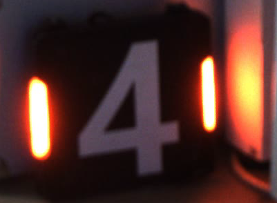

# 01｜图像、Mat、ROI 与窗口

本章对应 `src/image_base/main.cpp` 和 `src/task_01/main.cpp`。一张图像在 OpenCV 中通常由 `cv::Mat` 表示：它记录宽高、数据类型、通道数和像素数据。OpenCV 的图像坐标原点在左上角，x 向右、y 向下。



## 主要接口

| 接口 | 作用 | 例子 |
|---|---|---|
| `imread(path, flags)` | 读图；默认按彩色 BGR 读取。文件不存在或解码失败时返回空 `Mat`。 | `Mat src = imread("../image/task01_a.png"); if (src.empty()) return -1;` |
| `Mat::clone()` | 创建像素数据的独立深拷贝。 | `Mat copy = src.clone();` |
| `Mat::copyTo(dst)` | 把像素复制到目标矩阵；目标为空时会分配空间。 | `src.copyTo(copy);` |
| `Mat::zeros/ones(size,type)` | 建立指定尺寸和类型的全零/全一矩阵。 | `Mat mask = Mat::zeros(Size(320,240), CV_8UC1);` |
| `Rect(x,y,w,h)`、`src(rect)` | 用左上角与宽高描述矩形 ROI。ROI 是原图数据的视图，通常与源图共享像素。 | `Mat roi = src(Rect(20,30,100,80)).clone();` |
| `cvtColor(src,dst,code)` | 在颜色空间之间变换，例如 BGR→灰度、BGR→HSV。 | `cvtColor(src, gray, COLOR_BGR2GRAY);` |
| `split(src, channels)` | 将多通道图像拆成多个单通道矩阵。 | `vector<Mat> ch; split(src,ch);` |
| `imwrite(path, image)` | 按扩展名编码并保存图像，返回是否成功。 | `imwrite("gray.png", gray);` |
| `namedWindow`、`resizeWindow`、`imshow` | 创建窗口、调整窗口大小、显示图像。 | `namedWindow("view", WINDOW_NORMAL); imshow("view", src);` |
| `waitKey(delay)` | 等键盘事件；`0` 表示一直等待，正数表示毫秒超时。也负责 GUI 事件处理。 | `waitKey(0);` |
| `destroyAllWindows()` | 关闭 OpenCV 创建的窗口。 | `destroyAllWindows();` |
| `setMouseCallback(name, callback, userdata)` | 给窗口安装鼠标回调，可把自定义上下文指针传入回调。 | `setMouseCallback("view", onMouse, &points);` |

## 深拷贝、浅拷贝与 ROI

`Mat b = a` 通常只复制矩阵头并共享图像缓冲区；修改 `b` 的像素也可能影响 `a`。`clone()` 和 `copyTo()` 则复制像素数据。

`src(Rect(...))` 也共享源图内存。需要对裁剪区域做独立的原地处理时，应使用 `src(rect).clone()`。矩形必须满足 `x >= 0`、`y >= 0`、`x + width <= cols`、`y + height <= rows`；否则会触发断言。

## 类型与颜色通道

- `CV_8UC1`：8 位无符号、单通道，常用于灰度图或二值掩模。
- `CV_8UC3`：8 位无符号、三通道，普通彩色图像通常按 B、G、R 顺序保存。
- `Scalar(b,g,r)` 在 BGR 图上按蓝、绿、红填充。显示颜色与数值顺序不要按 RGB 理解。

灰度转换示例：

```cpp
Mat gray;
cvtColor(src, gray, COLOR_BGR2GRAY);
imwrite("gray.png", gray);
```

窗口示例：

```cpp
namedWindow("image", WINDOW_NORMAL);
resizeWindow("image", 800, 600);
imshow("image", src);
waitKey(0);
destroyAllWindows();
```
