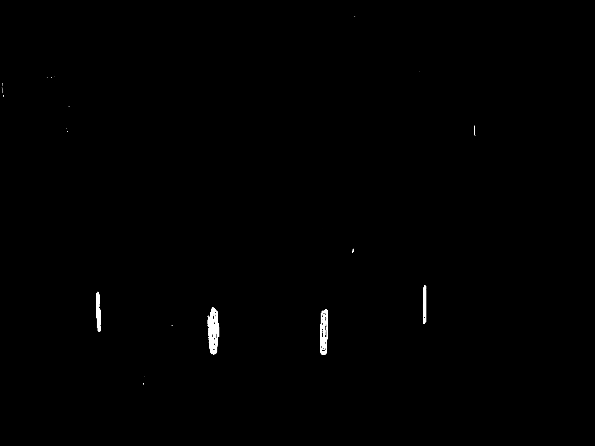
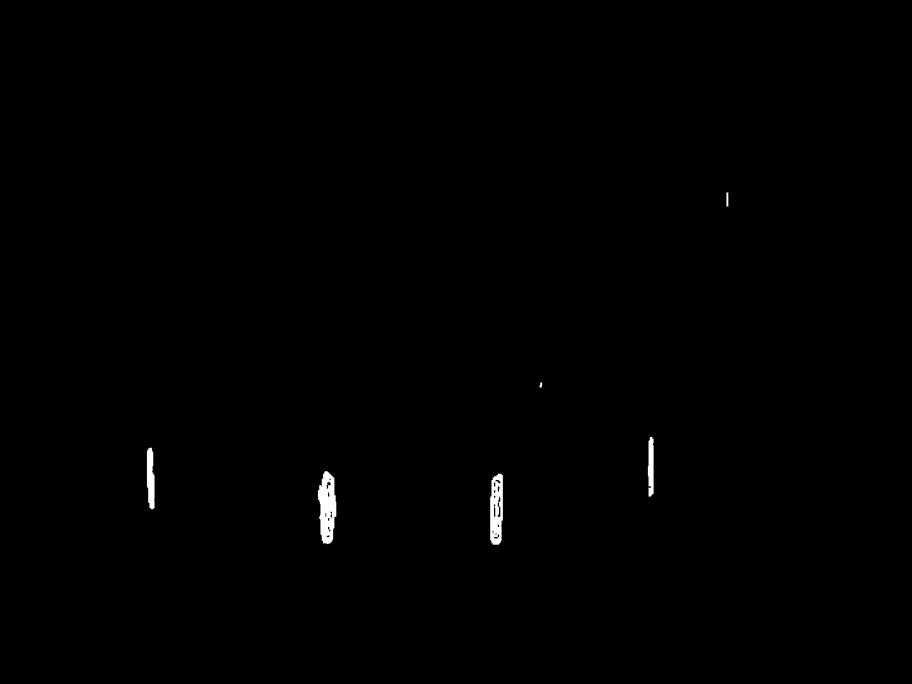
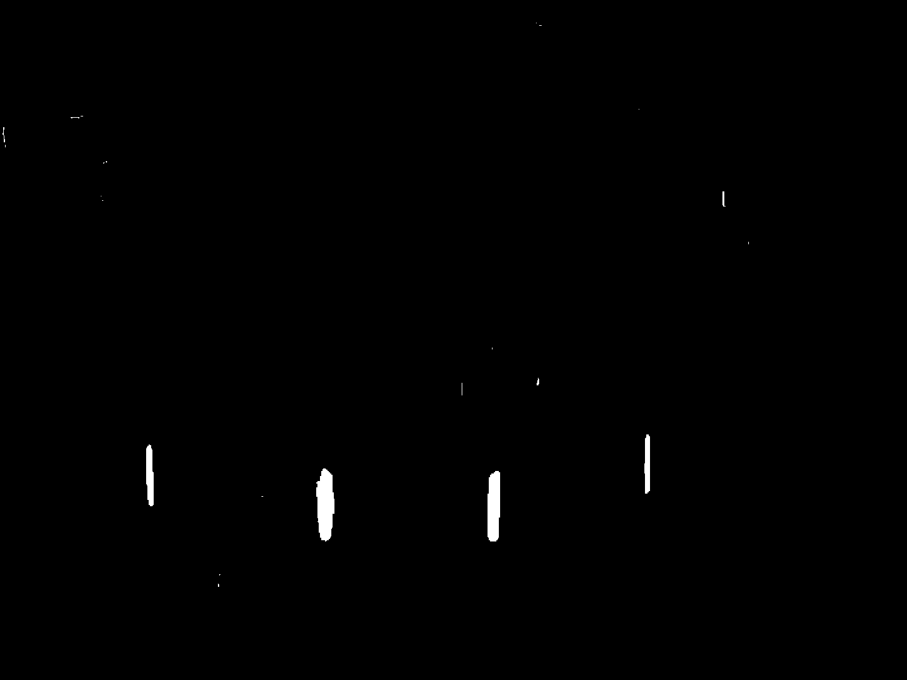

# 02｜颜色空间、阈值与形态学

本章对应 `src/task_02/main.cpp` 和 `include/lighting_cap.hpp`。典型颜色检测流程是：BGR 转 HSV → 范围阈值变成二值掩模 → 形态学修补掩模 → 把掩模送给轮廓检测。

| 处理阶段 | 示例图 |
|---|---|
| HSV 阈值掩模 |  |
| 开运算去除小噪声 |  |
| 闭运算填补小孔与断裂 |  |

## 主要接口

| 接口 | 作用 | 例子 |
|---|---|---|
| `cvtColor(..., COLOR_BGR2HSV)` | 把 BGR 像素转换成 HSV，便于按色相、饱和度、亮度范围筛选。 | `cvtColor(frame, hsv, COLOR_BGR2HSV);` |
| `inRange(src, lower, upper, dst)` | 对每个通道做闭区间范围判断，符合的像素输出 255，否则为 0。 | `inRange(hsv, Scalar(90,80,50), Scalar(130,255,255), mask);` |
| `bitwise_or(a,b,dst)` | 对掩模逐像素做按位或。红色跨过 HSV 色相环的两端，通常要分两段阈值再合并。 | `bitwise_or(red1, red2, red);` |
| `getStructuringElement(shape,size)` | 生成形态学核。矩形、椭圆、十字形核有不同邻域形状。 | `Mat k = getStructuringElement(MORPH_RECT, Size(3,3));` |
| `morphologyEx(src,dst,op,kernel)` | 执行复合形态学运算。`MORPH_OPEN` 是先腐蚀再膨胀；`MORPH_CLOSE` 是先膨胀再腐蚀。 | `morphologyEx(mask, clean, MORPH_OPEN, k);` |
| `imwrite(path,image)` | 保存掩模和中间结果，方便调阈值时对比。 | `imwrite("mask.png", mask);` |

## 为什么红色要分两段

HSV 的 H 表示色相，OpenCV 8 位 HSV 中 H 的范围是 0–179。红色接近色相环的起点和终点，所以一段 `[0,10]` 往往只能抓到一部分红色；代码用 `[0,10]` 和 `[170,179]` 两个区间，再通过 `bitwise_or` 合并。

## 形态学直觉

- **腐蚀**缩小白色前景：去除细小白点，也可能让细目标断开。
- **膨胀**扩大白色前景：连接邻近区域，也可能把小间隙填满。
- **开运算**先腐蚀后膨胀：倾向于移除小白噪点，同时恢复较大目标的尺寸。
- **闭运算**先膨胀后腐蚀：倾向于填小黑孔、连接短裂缝。

核尺寸越大，作用越强，也越容易损伤窄小目标。调参时应保存阈值掩模和每一步形态学结果，而不是只看最后的检测框。

## 颜色阈值助手

`get_blue_mask(Mat&)` 返回蓝色范围掩模；`get_red_mask(Mat&)` 返回两个红色区间合并后的掩模。函数输入应已是 HSV 图像，传入 BGR 会用错通道含义。代码中蓝色阈值为 H 90–130、S 80–255、V 50–255；红色阈值在头文件中单独列出。这些值依赖光照、相机白平衡和曝光。
