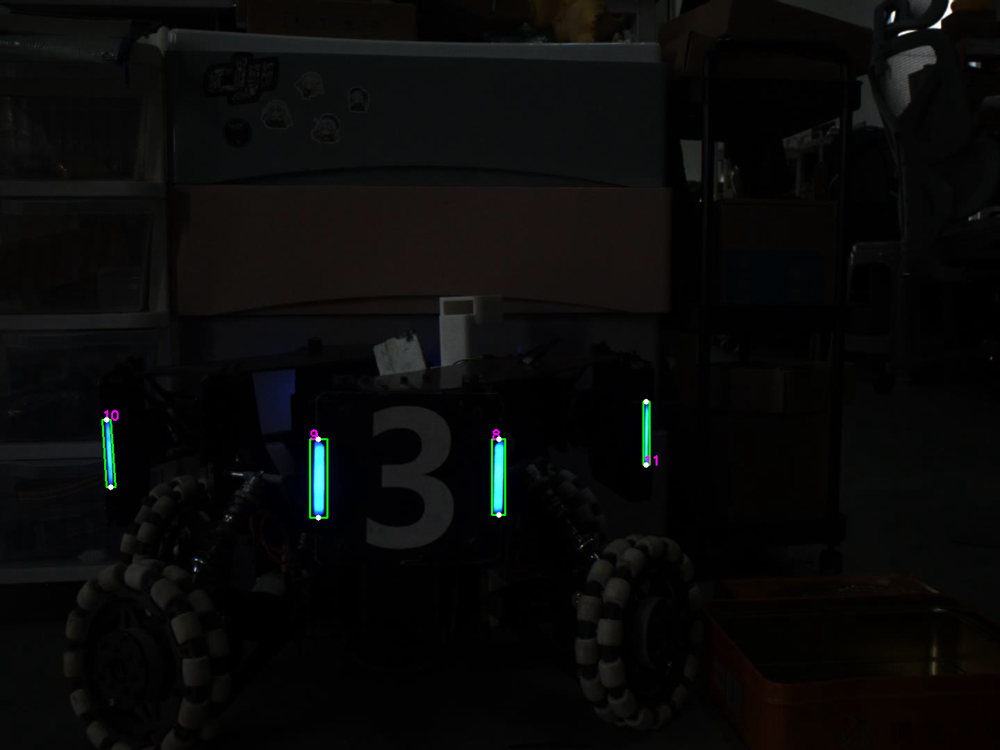

# 03｜轮廓、旋转矩形与灯条筛选

本章对应 `src/task_03/main.cpp`、`src/task_04/main.cpp` 及 `include/lighting_cap.hpp`。前提是输入单通道二值掩模：`findContours` 提取连通边界，几何特征再用于筛除不像灯条的轮廓。

## 主要接口

| 接口 | 作用 | 例子 |
|---|---|---|
| `findContours(image, contours, mode, method)` | 从二值图提取边界点集合。`RETR_EXTERNAL` 只取最外层轮廓；`CHAIN_APPROX_SIMPLE` 压缩水平/垂直/斜线上的冗余点。 | `findContours(mask, contours, RETR_EXTERNAL, CHAIN_APPROX_SIMPLE);` |
| `contourArea(contour)` | 计算轮廓包围的面积，可过滤小噪声。 | `if (contourArea(c) > 150) ...` |
| `minAreaRect(contour)` | 返回包围轮廓的最小面积旋转矩形 `RotatedRect`，包含 `center`、`size`、`angle`。 | `RotatedRect r = minAreaRect(c);` |
| `RotatedRect::points(points)` | 把旋转矩形四个顶点写入数组。 | `Point2f p[4]; r.points(p);` |
| `norm(p1-p2)` | 计算两个点差的欧氏长度，可从四个顶点中辨认长边。 | `float len = norm(p[0] - p[1]);` |
| `atan2(y,x)` | 从分量计算带象限信息的弧度角。代码用 `atan2(abs(dx),abs(dy))` 得到相对竖直方向偏角，再转度数。 | `float deg = atan2(abs(dx),abs(dy))*180/CV_PI;` |
| `line`、`circle`、`putText` | 在图像上标注框边、点和编号；颜色仍按 BGR。 | `line(dst,p[0],p[1],Scalar(0,255,0),2);` |
| `Mat::clone()` | 在原图副本上绘制，避免改写输入图。 | `Mat result = src.clone();` |

## 筛选逻辑

示例根据面积、长宽比和方向角选择细长近竖直的候选区域。`RotatedRect::size.width` 与 `height` 的大小顺序不稳定，因此先用 `max(width,height)` 作为长边、`min(...)` 作为短边，再计算比值。旋转矩形的角度字段会随宽高和方向表达而变化；代码改为从顶点向量测角，避免直接把 `RotatedRect::angle` 当成竖直偏角。

当前任务使用的阈值约为面积大于 150 像素、长宽比 3.5–15、偏离竖直方向小于 5°。这些是当前样例的经验筛选条件。远近变化或分辨率变化时，应重新估计阈值。

## 自定义接口

- `calculate_draw(src, contours, index_rect)`：逐个轮廓求最小旋转矩形并按条件筛选；返回画框副本，并把合格轮廓的索引放入 `index_rect`。
- `draw_rect(src, points, color)`：用四条 `line` 连接四个点。
- `draw_doub_light(src, light_id, contours)`：按候选索引对求两矩形中心，返回每对灯条的中点，并在图上标出端点。

同名 `calculate_draw` 在 `task_03`、`task_04` 和两个头文件中实现细节并不完全相同；调用某个目标时要确认实际编译进来的定义，避免把多个定义放入同一翻译单元造成重定义。
