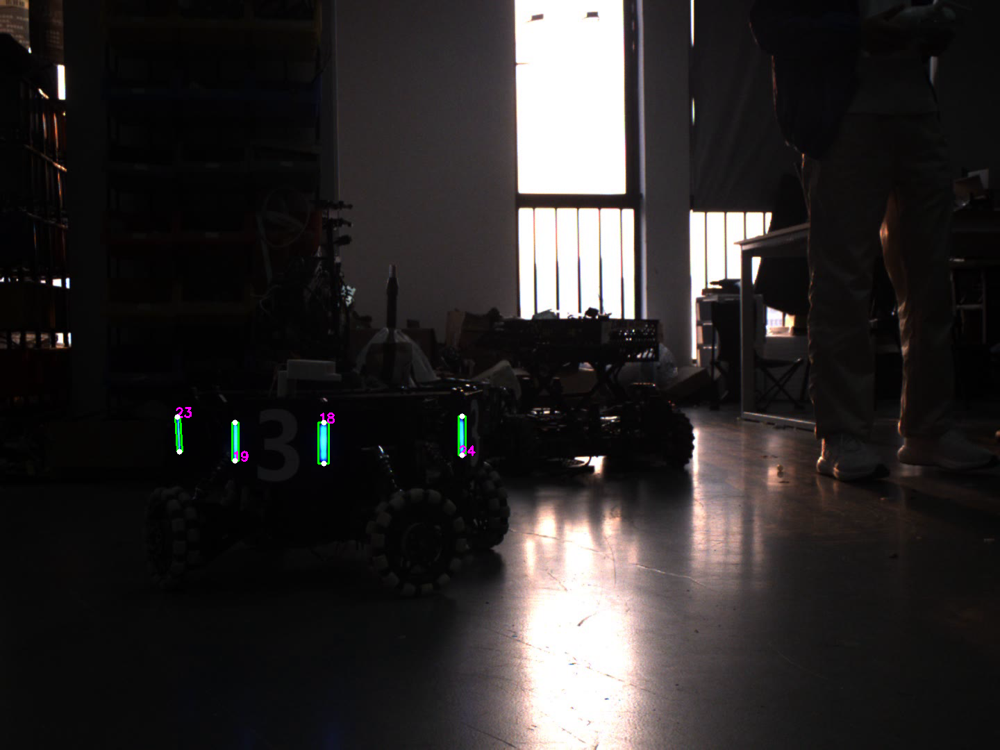

# 04｜灯条配对与透视变换

本章对应 `src/task_04/main.cpp` 和 `include/lighting_cap.hpp`。颜色分割得到多个细长候选后，需要判断哪两根组成同一块装甲板。代码比较两根灯条的长度比例、方向差和中心间距比例。

## 配对几何量

设两灯条长边长度为 `L1`、`L2`，中心为 `C1`、`C2`：

- 长度比 `RL = min(L1,L2) / max(L1,L2)`，接近 1 表示长度相似。
- 角度差 `Δθ = |θ1 - θ2|`，小表示两根灯条近似平行。
- 归一化间距 `RD = ||C1-C2|| / ((L1+L2)/2)`，除以平均灯条长度以减少图像尺度变化影响。

代码里的一组样例条件是 `RL > 0.6`、`Δθ <= 1°`、`1.5 < RD < 2.5`。真实项目还应限制两灯条的上下倾斜、左右顺序、矩形宽度、重叠候选和目标尺寸。

## 主要接口

| 接口 | 作用 | 例子 |
|---|---|---|
| `calculate_light(contours, rect_index)` | 遍历合格候选两两组合，按 `RL`、`Δθ`、`RD` 筛选，返回轮廓索引对。 | `auto pairs = calculate_light(contours, valid_ids);` |
| `getPerspectiveTransform(src,dst)` | 根据四组对应二维点求 3×3 单应矩阵，描述一个平面到另一个平面的透视映射。 | `Mat H = getPerspectiveTransform(src4, dst4);` |
| `warpPerspective(src,dst,H,size)` | 对输入图像应用单应变换并重采样，得到指定尺寸的视图。 | `warpPerspective(src, flat, H, Size(800,400));` |
| `imwrite(path,image)` | 保存展开结果，可用于查看角点顺序是否正确。 | `imwrite("flat.png", flat);` |

## 透视变换的原理

平面上的点可用齐次坐标写成 `p = (x,y,1)^T`。单应矩阵 `H` 将源图点映射到目标平面：`p' ~ H p`，其中 `~` 表示齐次比例等价。四对不共线对应点足以解出 3×3 矩阵的 8 个独立自由度。`getPerspectiveTransform` 求 `H`，`warpPerspective` 对输出图每个像素做逆映射和插值。

示例把装甲板的四角映射到 800×400 的矩形。点的排列顺序必须一致：源点和目标点分别按左上、左下、右下、右上等同一方向列出。顺序错乱时会出现翻转、蝴蝶结或严重扭曲。四角应近似属于同一平面；明显弯曲或不同深度的点无法由单个平面单应矩阵准确解释。

## 自定义接口

`use_perspectTrans(input_src, src_points)` 接收四个源角点，内部构造 800×400 目标四点，调用 `getPerspectiveTransform` 和 `warpPerspective`，返回展开图。`draw_point` 先根据两根灯条的长轴端点拼出四角，再调用同样的变换流程并写入 PNG。
