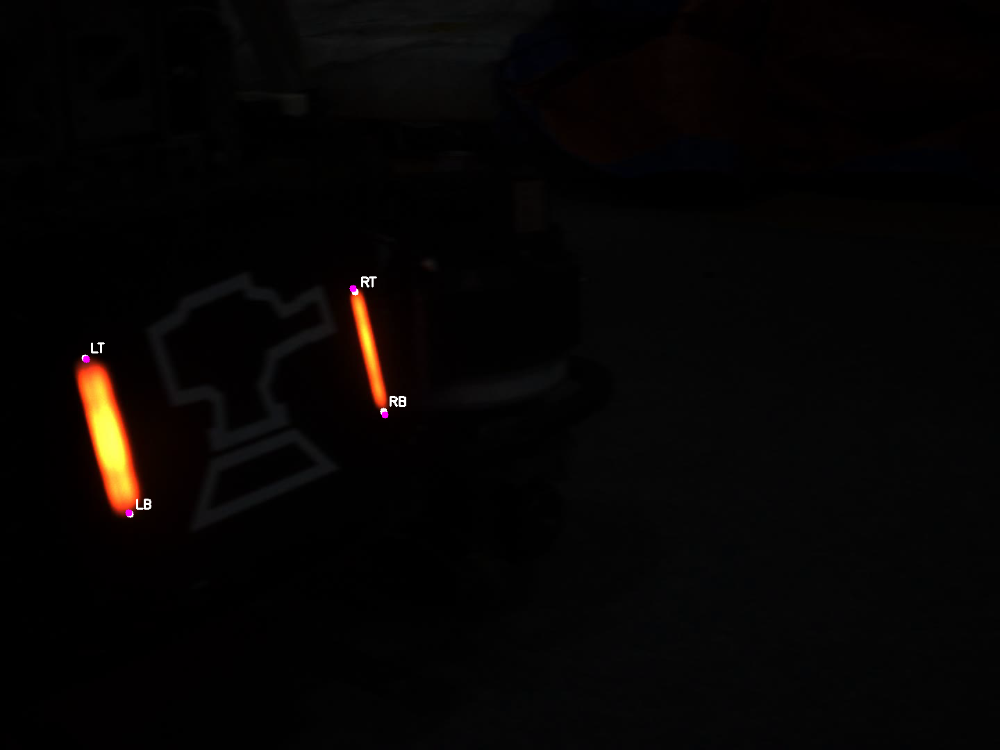

# 05｜PnP 位姿估计与重投影误差

本章对应 `src/task_05/main.cpp` 和 `include/task_func.hpp`。PnP（Perspective-n-Point）用已知的物体三维点和图像二维观测点，估计物体相对相机的旋转和平移。它回答的是“这个已知几何物体在相机坐标系里的姿态是什么”。



## 几何模型

物体点 `X_i` 经物体到相机的刚体变换后成为相机点：

`X_camera = R X_object + t`

理想针孔投影为：

`u ~ K [R|t] X_object`

- `K` 是相机内参矩阵，含焦距和主点。
- `R` 是三维旋转，代码以旋转向量 `rvec` 表示；`Rodrigues(rvec)` 可将其转换为 3×3 旋转矩阵。
- `t` 是平移向量 `tvec`，表示物体坐标原点在相机坐标系中的位置，单位与三维模型点相同。
- 畸变系数描述镜头非理想投影。相机参数必须来自与当前图像分辨率、裁剪和缩放设置相匹配的标定。

`solvePnP` 通过最小化观测像素点与投影点之间的重投影差来求姿态。四个点的平面目标可能存在多解或对噪声敏感；点应覆盖足够范围、几何顺序要对应、相机标定要准确。非平面分布通常更利于约束姿态。

## 主要接口

| 接口 | 作用 | 例子 |
|---|---|---|
| `FileStorage(path, READ)` | 打开 OpenCV YAML/XML 参数文件。 | `FileStorage fs("camera.yml", FileStorage::READ);` |
| `fs["key"] >> mat` | 从配置节点读出相机内参或畸变系数。 | `fs["camera_matrix"] >> K;` |
| `FileStorage::release()` | 关闭配置文件。 | `fs.release();` |
| `solvePnP(object,image,K,dist,rvec,tvec)` | 根据对应的 3D/2D 点、相机矩阵和畸变估计姿态，返回是否成功。 | `bool ok = solvePnP(obj, img, K, dist, rvec, tvec);` |
| `projectPoints(object,rvec,tvec,K,dist,image_out)` | 用估计姿态把 3D 点重新投影到像素坐标。 | `projectPoints(obj, rvec, tvec, K, dist, projected);` |
| `norm(tvec)` | 计算平移向量长度；`tvec[2]` 是相机坐标系的 Z 深度。 | `double range = norm(tvec);` |
| `calculate_rmse(obs,pred)` | 计算像素重投影误差：`sqrt(sum(dx²+dy²)/N)`，单位为像素。 | `double e = calculate_rmse(image_points, projected);` |
| `setMouseCallback` | 通过 `EVENT_LBUTTONDOWN` 获取用户点击像素，用作二维图像观测点。 | `setMouseCallback("view", onClick, &points);` |

## 从代码到结果

1. 从 `object_points.csv` 读出目标模型的 `Point3f`，点的顺序必须和图像中的对应角点一一一致。
2. 从 `reference_corners.csv` 或人工点击得到 `Point2f` 图像点。
3. 从 `camera.yml` 读取内参和畸变系数。
4. 调用 `solvePnP` 得到 `rvec` 和 `tvec`。
5. 调用 `projectPoints` 生成理论像素位置，再与观测点算 RMSE。

当 `tvec.z > 0`，物体原点位于相机前方；这只是必要的基本合理性检查，不足以证明整组姿态都有效。还应检查各三维点变换后的深度、重投影误差、点序和姿态连续性。RMSE 越小表示在当前标定与点对应下像素拟合更好，但它不等同于真实距离误差，也无法排除整体尺度单位错误。

## 易错点

- `object_points[i]` 与 `image_points[i]` 必须代表同一个物理点。
- `tvec` 单位由模型坐标决定。模型用米则平移为米；用毫米则结果为毫米。
- `solvePnP` 的输入点数量和几何配置必须满足选定求解方法的约束；需要更多容错时可指定 `SOLVEPNP_ITERATIVE`、RANSAC 变体等方法，并检查返回状态。
- 示例用 `at<double>` 读取向量；若更换输出精度或自定义类型，应先检查矩阵深度，避免类型不匹配。
- RMSE 代码要求两组数组等长且非空；正式代码需先检查 `N > 0` 和对应点数一致。

## `solvePnP` 怎么传参

常用重载的参数顺序如下：

```cpp
bool solvePnP(
    InputArray objectPoints,       // N 个物体坐标 Point3f/Point3d
    InputArray imagePoints,        // N 个对应像素点 Point2f/Point2d
    InputArray cameraMatrix,       // 3x3 相机内参 K
    InputArray distCoeffs,         // 畸变系数；无畸变时可传 Mat()
    OutputArray rvec,              // 输出旋转向量
    OutputArray tvec,              // 输出平移向量
    bool useExtrinsicGuess=false,  // 是否用传入的 rvec/tvec 作初始值
    int flags=SOLVEPNP_ITERATIVE   // 求解方法
);
```

`objectPoints[i]` 与 `imagePoints[i]` 必须是同一个角点。`cameraMatrix` 是标定所得的 `K`，不是图像矩阵；`distCoeffs` 要与该相机和成像设置匹配。首次求解把 `useExtrinsicGuess` 设为 `false`。`flags` 可先用 `SOLVEPNP_ITERATIVE`；选择 P3P/AP3P 等方法时要满足各自点数、几何约束。

以下片段展示本项目的文件键名和参数传递方式。`objectPoints`、`imagePoints` 应按同一角点顺序提前读入：

```cpp
Mat K, distCoeffs;
FileStorage fs("../image/task05/camera.yml", FileStorage::READ);
if (!fs.isOpened()) return -1;
fs["cameratrix_ma"] >> K;
fs["distortion_coefficients"] >> distCoeffs;
fs.release();

vector<Point3f> objectPoints;  // 物体坐标，单位例如米
vector<Point2f> imagePoints;   // 对应像素坐标
// ...把同一批角点依次 push_back 到两个数组，且下标对应
if (objectPoints.size() != imagePoints.size() || objectPoints.size() < 4)
    return -1;

Mat rvec, tvec;
bool ok = solvePnP(objectPoints, imagePoints, K, distCoeffs,
                   rvec, tvec, false, SOLVEPNP_ITERATIVE);
if (!ok) return -1;
cout << "rotation vector = " << rvec << "\n"
     << "translation = " << tvec << "\n";
```

这一步中各实参的“输入/输出”方向很重要：前四项是已知输入；`rvec` 与 `tvec` 是 OpenCV 写出的结果。`useExtrinsicGuess=true` 时，输出矩阵还同时是初始猜测，不能传空值。`tvec` 单位沿用 `objectPoints` 的长度单位。

### 重投影并画出测量点与预测点

```cpp
vector<Point2f> projected;
projectPoints(objectPoints, rvec, tvec, K, distCoeffs, projected);

Mat display = image.clone();
for (size_t i = 0; i < imagePoints.size(); ++i) {
    Point observed(cvRound(imagePoints[i].x), cvRound(imagePoints[i].y));
    Point predicted(cvRound(projected[i].x), cvRound(projected[i].y));
    circle(display, observed, 5, Scalar(0, 255, 0), FILLED); // 观测点：绿实心圆
    circle(display, predicted, 7, Scalar(255, 0, 255), 2);   // 重投影：紫色空心圆
    line(display, observed, predicted, Scalar(0, 255, 255), 1); // 两者偏差
}
double rmsePx = calculate_rmse(imagePoints, projected);
cout << "reprojection RMSE = " << rmsePx << " px\n";
imwrite("pnp_check.png", display);
```

`projectPoints` 的前三个必需参数是物体三维点、`rvec`、`tvec`，后面接同一次求解使用的 `K` 和畸变系数，最后输出像素点数组。图中绿点是人工/检测到的像素观测，紫色圆是 PnP 姿态重新投影的预测点，连线长度显示每个点的重投影残差。

项目封装 `pnp_calculate(K, distCoeffs, objectPoints, imagePoints)` 已经完成 `solvePnP`、打印 `rvec/tvec`、检查 `tvec.z`、调用 `projectPoints` 并计算 RMSE；返回值是重投影 `vector<Point2f>`，失败时为空数组。它不把姿态作为返回值，因此若后续还要用 `rvec/tvec`，应像上面的原始接口示例那样直接调用 `solvePnP`，或扩展封装的输出参数。


## 调用本项目的 PnP 封装

如果只需要得到重投影点并在终端查看位姿和误差，可复用 `include/task_func.hpp` 中的两个接口：

```cpp
Mat K, distCoeffs;
read_camera_config(K, distCoeffs, "../image/task05/camera.yml");

vector<Point3f> objectPoints; // 已按角点顺序加载
vector<Point2f> imagePoints;  // 同顺序的图像像素点
vector<Point2f> projected =
    pnp_calculate(K, distCoeffs, objectPoints, imagePoints);
if (projected.empty()) {
    cerr << "PnP 求解失败\n";
}
```

- `read_camera_config(K, distCoeffs, file)`：第 1、2 个参数是输出矩阵，第 3 个参数是 YAML 文件路径；文件中的键名应为 `cameratrix_ma` 和 `distortion_coefficients`。
- `pnp_calculate(K, distCoeffs, objectPoints, imagePoints)`：依次传入内参、畸变、三维物点和二维观测点。返回预测像素点数组；内部解出的 `rvec/tvec` 只打印，不随返回值带出。
- 此封装没有做空文件、点数和数组等长检查；正式调用前要验证两个点集有效且一一对应。若需要设置 `flags`、保留姿态或处理离群点，直接使用前面的 `solvePnP` 调用或扩展封装。
