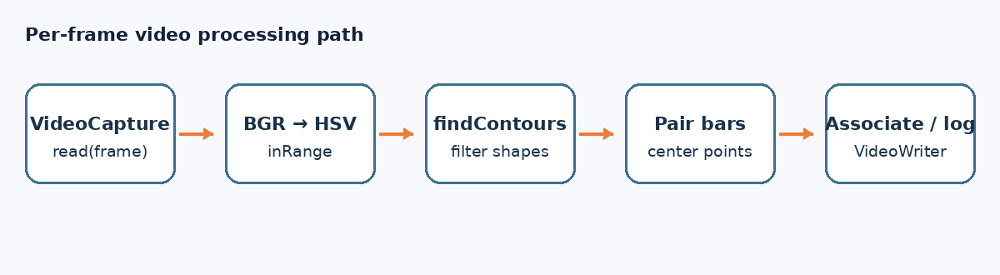

# 06｜视频读写与目标关联

本章对应 `src/task_06/main.cpp`、`src/cap_video/main.cpp` 和 `include/task_func.hpp` 中的 `traker`。Task 06 将每帧处理成颜色掩模、候选轮廓和灯条中心，并把检测状态与耗时写入 CSV。



## 主要接口

| 接口 | 作用 | 例子 |
|---|---|---|
| `VideoCapture(path)` | 打开视频文件或摄像头。应检查 `isOpened()`，否则读取循环可能没有帧。 | `VideoCapture cap("input.avi");` |
| `cap.read(frame)` | 解码下一帧；成功得到非空图像时返回 `true`。 | `while (cap.read(frame)) { ... }` |
| `cap.get(CAP_PROP_FPS/FRAME_WIDTH/FRAME_HEIGHT)` | 查询视频帧率和尺寸，常用于配置输出视频。 | `double fps=cap.get(CAP_PROP_FPS);` |
| `VideoWriter(path,fourcc,fps,size)` | 创建视频编码器和输出文件。帧尺寸、帧率、通道格式要与输入一致。 | `VideoWriter out("out.avi", VideoWriter::fourcc('M','J','P','G'), fps, size);` |
| `writer.write(frame)` | 写入一帧；先确认 writer 打开成功且帧大小正确。 | `writer.write(frame);` |
| `release()` | 释放解码器/编码器资源，确保视频封装完成。 | `cap.release(); writer.release();` |
| `TickMeter::start/stop/reset/getTimeMilli` | 对代码片段计时并取得毫秒耗时。 | `timer.start(); process(); timer.stop(); double ms=timer.getTimeMilli();` |
| `ofstream` | 输出 CSV 表头与逐帧记录。它是 C++ 标准库接口，不是 OpenCV 接口。 | `csv << "frame,x,y\n";` |
| `norm(a-b)` | 计算检测中心与历史跟踪点之间的欧氏距离。 | `float d=norm(center-last_center);` |

## 帧循环结构

```cpp
VideoCapture cap("input.avi");
if (!cap.isOpened()) return -1;
Mat frame;
while (cap.read(frame)) {
    // 颜色转换 → 阈值掩模 → 轮廓 → 几何筛选 → 记录/可视化
}
cap.release();
```

`VideoWriter::fourcc('M','J','P','G')` 指定 MJPG 编码。容器扩展名和编码器组合需要当前 OpenCV/FFmpeg 构建支持；实际运行时要检查 `writer.isOpened()`。

## 基础中心点关联

`traker(center_point, track_point)` 是距离门限式的演示关联：对已有中心找一个距离不超过 100 像素的当前检测，更新中心和丢失帧计数；连续丢失超过 10 帧时输出丢失信息。`track_point` 元素是 `(历史中心, 丢失次数)`。

这个函数适合说明“检测”和“跟踪 ID 关联”是两个步骤，但当前实现不是稳健的多目标分配算法：可能把一个检测重复分给多个轨迹，候选遍历顺序会影响结果，新增目标索引也可能重复。多目标场景通常需建立预测位置与检测之间的代价矩阵，再用匈牙利算法/全局最近邻进行一对一匹配，并配合门控、轨迹创建和销毁策略。卡尔曼滤波提供预测位置，本身不负责目标身份匹配。

## 视频输入说明

仓库为减小体积不包含 Task 06/07 的原始 AVI。将自己的测试视频放在代码使用的 `image/task06_a.avi`、`image/task06_b.avi` 和 `image/task07.avi`，同时确保 `image_output/task06/`、`image_output/task07/` 可写。`src/cap_video` 示例所需的 `video/031.mp4` 也未提交。
