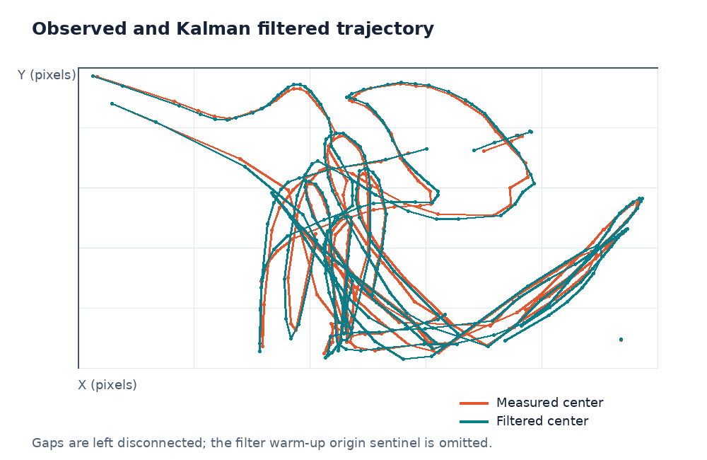

# 07｜卡尔曼滤波目标跟踪

本章对应 `src/task_07/main.cpp`。卡尔曼滤波把“运动模型预测”和“图像测量”融合起来，用内部状态估计目标位置和速度。在检测有噪声时，它能平滑轨迹；检测偶尔缺失时，可以短时间外推位置。

## 状态和测量

当前程序使用四维状态与二维测量：

`x_k = [p_x, p_y, v_x, v_y]^T`，`z_k = [p_x, p_y]^T`

其中位置单位是像素，速度单位是像素/帧。常速度转移模型为：

`x_k = A x_(k-1) + w_k`

`z_k = H x_k + v_k`

当帧间隔 `Δt` 固定时：

```text
A = [1 0 Δt 0]
    [0 1 0 Δt]
    [0 0 1  0]
    [0 0 0  1]

H = [1 0 0 0]
    [0 1 0 0]
```

`A` 表示匀速外推位置、保持速度；`H` 表示摄像头只直接观测位置，不直接测速度。

## 预测和校正的原理

滤波器同时维护状态估计 `x` 和误差协方差 `P`。

**预测：**

`x⁻ = A x`，`P⁻ = A P Aᵀ + Q`

**得到测量后校正：**

`K = P⁻ Hᵀ (H P⁻ Hᵀ + R)⁻¹`

`x = x⁻ + K (z - H x⁻)`，`P = (I - K H) P⁻`

`K` 是卡尔曼增益：预测不确定性大或测量噪声小时，算法更信测量；预测可信或测量噪声大时，更信运动模型。预测和测量不是简单平均，权重由协方差按每一维动态计算。



该图根据仓库里已有的 `image_output/task07/cap.csv` 和 `filter.csv` 轨迹记录绘制；无效帧间断线，滤波器启动阶段的 `(0,0)` 占位值不参与绘图。

## OpenCV 接口与矩阵

| 接口/成员 | 作用 | 代码中的用途 |
|---|---|---|
| `KalmanFilter::init(dynamParams, measureParams, controlParams, type)` | 分配滤波器矩阵；此处状态 4 维、测量 2 维、无控制输入、32 位浮点。 | `kf.init(4,2,0,CV_32F);` |
| `transitionMatrix` | 状态转移矩阵 `A`。 | 编码 `x+=vx*dt`、`y+=vy*dt`。 |
| `measurementMatrix` | 测量矩阵 `H`。 | 只从状态中取出 x、y。 |
| `processNoiseCov` | 过程噪声协方差 `Q`，描述匀速模型未包含的加速度等变化。 | 使用白噪声加速度模型构造。 |
| `measurementNoiseCov` | 测量噪声协方差 `R`，描述颜色阈值、轮廓边界和圆心估计带来的位置误差。 | 设为 `diag(r,r)`。 |
| `statePost` | 最近一次校正后的后验状态。 | 用前两帧检测中心初始化位置和速度。 |
| `errorCovPost` | 后验状态协方差。 | 表示校正后各状态的不确定性；初始化时也应合理赋值。 |
| `predict()` | 执行时间更新，返回当前测量到来前的状态预测。 | `Mat prediction = kf.predict();` |
| `correct(measurement)` | 把本帧测量融入预测并返回后验状态。 | `Mat corrected = kf.correct(measurement);` |
| `minEnclosingCircle(points, center, radius)` | 求包含轮廓所有点的最小圆。 | 以轮廓中心近似篮球中心，并取得绘图半径。 |

## `Q`、`R` 的调节

- 增大 `Q` 表示实际运动更可能偏离匀速模型，滤波器通常会更快接纳新观测，但预测更不稳定。
- 增大 `R` 表示图像测量更不可靠，滤波器更信预测，轨迹更平滑但更可能滞后。
- 程序中的 `q=0.5` 和 `r=2.3` 是当前分辨率和单位下的经验参数。`R` 的对角值是位置测量方差，量纲为像素平方；实际应通过静止目标/标注数据估计噪声，而不是把数字当成通用“平滑强度”。
- `Q` 必须与状态单位、帧间隔和噪声模型一致。帧率变化时，`Δt` 应用真实秒数重新计算，不能固定为 1 后仍把速度解释为像素/秒。

## 当前实现中的注意点

1. 初始化速度使用前两次可检测中心差，假设两次观测间隔恰为一帧；若中间丢帧，应除以实际帧数或时间间隔。
2. 首次初始化后应设置合理的 `errorCovPost`；矩阵的不确定性会影响初期卡尔曼增益。
3. 检测缺失时本代码只做 `predict()` 并绘制预测中心，不调用 `correct()`。这属于短时纯预测，连续丢帧越多误差通常越大；应设置最大外推帧数并在恢复检测时做关联判断。
4. 当前 `statePost` 初始化取的是最近一次检测的中心，速度是前两中心差；要确保位置、速度都对应同一时刻。
5. 只有一个最大面积轮廓被选作目标。多目标跟踪需要先做检测—轨迹关联，为每个轨迹维护自己的滤波器。
