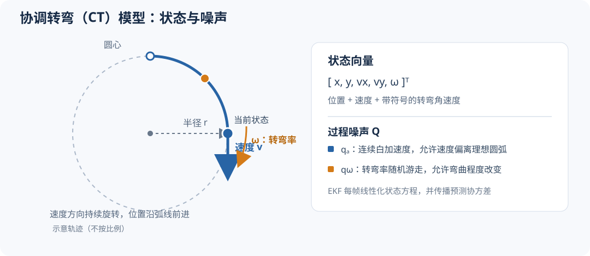

# 08｜替换运动模型与过程噪声

考核题目可能更换目标运动规律。此时不能只改 `Q`：状态向量、状态转移矩阵 `A`、观测矩阵 `H` 和过程噪声协方差 `Q` 必须描述同一个模型。本项目新增 `include/kalman_motion_models.hpp`，保留 Task 07 原来的匀速模型，同时提供可直接替换的初始化函数。

## 先分清运动模型和过程噪声

卡尔曼预测为：

`x(k|k-1) = A x(k-1|k-1)`

`P(k|k-1) = A P(k-1|k-1) Aᵀ + Q`

- `A` 描述理想状态如何随时间演化，例如位置由速度推进，或位置由速度和加速度共同推进。
- `Q` 描述真实运动偏离这个理想模型的程度及其在各个状态维度间的相关性。
- 如果考核把匀速改成匀加速，需要扩展状态并更改 `A`，不能只替换 `Q`。如果状态仍按匀速演化，但加速度噪声假设变了，可以保留 `A`，只替换 `Q`。

## 可选模型一览

| 初始化函数 | 状态顺序 | 运动假设 | 适合情况 |
|---|---|---|---|
| `init_random_walk_2d` | `[x,y]` | 位置下一帧围绕当前位置随机变化 | 目标近似静止或没有稳定速度信息 |
| `init_cv_discrete_white_accel` | `[x,y,vx,vy]` | 均值上匀速，每帧有随机加速度扰动 | 当前 Task 07 模型；短时、速度大体连续 |
| `init_cv_continuous_white_accel` | `[x,y,vx,vy]` | 均值上匀速，连续时间加速度为白噪声 | 帧间隔变化或以连续时间噪声强度建模 |
| `init_ca_white_jerk_2d` | `[x,y,vx,vy,ax,ay]` | 位置、速度、加速度作为状态，jerk（加速度变化率）是噪声 | 目标在短时内持续加速，或轨迹弯曲但加速度较平滑 |
| `init_ct_ekf_2d` + `predict_ct_ekf_2d` | `[x,y,vx,vy,ω]` | 匀速率转弯，转弯角速度允许随机游走 | 目标沿圆弧运动，速度方向持续旋转 |

初始化函数把 `A/H/Q/R` 和 `statePost` 设好，协方差初值为单位阵。第一次检测后应把位置、速度（必要时加速度或转弯角速度）写进 `kf.statePost`，不要把零状态当成真实目标位置。圆周模型是 EKF：每帧必须用 `predict_ct_ekf_2d` 计算非线性状态预测，再调用 OpenCV 的 `correct`；不能直接调用线性 `kf.predict()`。

## 原 Task 07：每帧随机加速度的匀速模型

原代码的状态是 `[x,y,vx,vy]`，其中 `dt=1` 是每帧时间单位。`A` 假设平均速度保持不变：

```text
x' = x + vx·dt       y' = y + vy·dt
vx' = vx             vy' = vy
```

Task 07 的 `Q` 在每个时间段引入一个随机但区间内恒定的加速度。以一维 `(x,vx)` 为例：

`G = [dt²/2, dt]ᵀ`，`Q = σ²ₐ G Gᵀ`

所以位置/速度块为：

```text
σ²ₐ [ dt⁴/4   dt³/2 ]
    [ dt³/2   dt²   ]
```

二维 x、y 分别使用相同块，交叉项为零。新增头文件中的 `init_cv_discrete_white_accel(kf, dt, q, r)` 按任意固定 `dt` 写出这个矩阵；当 `dt=1`、`q=0.5` 时，与原 `init_kalman_model` 的 `A/Q` 形式一致。这里 `q` 表示每帧加速度方差，单位依赖 `dt` 的时间单位。

```cpp
#include "kalman_motion_models.hpp"

cv::KalmanFilter kf;
kalman_models::init_cv_discrete_white_accel(kf, 1.0f, 0.5f, 2.3f);
// 状态是 [x,y,vx,vy]；用两个检测中心初始化位置和速度
kf.statePost = (cv::Mat_<float>(4,1) << x, y, vx, vy);
```

## 同为匀速状态：连续白加速度 `Q`

另一种常用假设是连续时间白加速度噪声。位置、速度的协方差块为：

```text
q [ dt³/3   dt²/2 ]
  [ dt²/2   dt    ]
```

这里的 `q` 是连续时间加速度噪声谱密度，不等于上一个函数的每帧加速度方差。把两种 `q` 当成同一数值来调通常不合理，切换后要重新标定噪声强度。

```cpp
kalman_models::init_cv_continuous_white_accel(kf, dt, qSpectral, rPosition);
kf.statePost = (cv::Mat_<float>(4,1) << x, y, vx, vy);
```

此函数和原模型的状态维度、`A`、`H` 一样，只改变 `Q` 的时间积分形式。适合想保持匀速状态方程、只换过程噪声假设的题目。

## 改成匀加速状态：白噪声 jerk

若题目明确要求把加速度也作为状态，改用 6 维状态：

`x = [pₓ,pᵧ,vₓ,vᵧ,aₓ,aᵧ]ᵀ`

状态转移为：

```text
p' = p + v·dt + ½a·dt²
v' = v + a·dt
 a' = a
```

对应 `A` 的位置—加速度系数为 `dt²/2`，速度—加速度系数为 `dt`。由于检测只提供位置，`H` 仍然只有两行，只从 6 维状态中取 `x/y`。

对每个轴，连续白 jerk 噪声的 `(position, velocity, acceleration)` 协方差块是：

```text
qⱼ [ dt⁵/20  dt⁴/8  dt³/6 ]
   [ dt⁴/8   dt³/3  dt²/2 ]
   [ dt³/6   dt²/2  dt     ]
```

头文件按状态顺序 `[x,y,vx,vy,ax,ay]` 把 x、y 两个块放到 6×6 的 `Q` 中。调用时状态要有 6 个分量：

```cpp
kalman_models::init_ca_white_jerk_2d(kf, dt, jerkSpectral, rPosition);
kf.statePost = (cv::Mat_<float>(6,1) << x, y, vx, vy, ax, ay);
```

若只有两次位置检测，可由差分估计 `vx/vy`，而把 `ax/ay` 初值设为 0；若有多帧观测，可用速度差估计加速度。初值越不确定，应把对应 `errorCovPost` 对角线设得越大。

## 随机游走位置模型

随机游走不显式保存速度：`x(k)=x(k-1)+w(k)`。它的 `A=I`、`H=I`，`Q=qₚI`。每次只把上一位置加上不确定扰动，适合缓慢漂移或静止目标，不适合长距离高速跟踪。

```cpp
kalman_models::init_random_walk_2d(kf, qPosition, rPosition);
kf.statePost = (cv::Mat_<float>(2,1) << x, y);
```

因为状态维数只有 2，取 `predict()` 返回值时只有位置，不存在 `vx/vy`。

## 圆周运动：匀速转弯 EKF 与转弯率噪声

若目标在一段时间内近似沿圆弧运动，匀速直线模型会持续把轨迹预测到切线上。这里采用 coordinated turn（CT，协调转弯）模型，状态为：



`x = [x, y, vx, vy, ω]ᵀ`

其中 `ω` 是带符号的转弯角速度，单位是弧度/秒（若 `dt` 用秒）；`ω>0` 表示速度方向按公式持续旋转。假设一个时间步内 `ω` 保持不变，令 `θ=ω·dt`、`a=sin(θ)/ω`、`b=(1-cos(θ))/ω`，离散运动方程是：

```text
x'  = x + a·vx - b·vy
y'  = y + b·vx + a·vy
vx' = cos(θ)·vx - sin(θ)·vy
vy' = sin(θ)·vx + cos(θ)·vy
ω'  = ω
```

这会同时旋转速度方向并沿圆弧推进位置；半径约为 `sqrt(vx²+vy²)/|ω|`。当 `ω→0` 时，模型退化到匀速直线。由于 `ω` 作为状态参与了三角函数，状态转移是非线性的；EKF 在当前状态附近计算雅可比矩阵 `F=∂f/∂x`，再传播协方差：

`P⁻ = F P Fᵀ + Q`

### 过程噪声怎么设

本实现使用一组实用的离散近似：x/y 方向的连续白加速度噪声，加上转弯率 `ω` 的随机游走。状态顺序是 `[x,y,vx,vy,ω]`，`Q` 的非零块为：

```text
Q[x,vx] = qₐ [ dt³/3  dt²/2 ]     Q[y,vy] 同理
                 [ dt²/2  dt    ]
Q[ω,ω]   = qω·dt
```

`qₐ` 是连续加速度噪声谱密度，`qω` 是转弯率随机游走的噪声谱密度；两者单位与位置单位、时间单位有关。增大 `qₐ` 会让滤波器更快接受速度/轨迹变化，增大 `qω` 会让它更快允许转弯率改变。这里的 `Q` 忽略了噪声经过转弯动力学后产生的状态相关耦合，是便于学习和调参的近似；大 `dt` 或剧烈转弯时应采用更精确的 CT 离散噪声模型，或用 UKF/IMM 比较多个运动模型。

### 初始化与调用

```cpp
#include "kalman_motion_models.hpp"

cv::KalmanFilter kf;
const float dt = 1.0f / 30.0f;          // 秒；下面速度单位是像素/秒
const float qAcceleration = 25.0f;      // 加速度噪声谱密度，需按数据调节
const float qTurnRate = 0.02f;           // 转弯率随机游走谱密度
const float rPosition = 4.0f;            // 检测位置测量方差，像素²

kalman_models::init_ct_ekf_2d(
    kf, dt, qAcceleration, qTurnRate, rPosition);

// 初始化为 [x, y, vx, vy, omega]。若还不知道速度/omega，
// 可先用连续几帧检测估计，并调大 errorCovPost 对应对角线。
kf.statePost = (cv::Mat_<float>(5, 1) <<
    x0, y0, vx0, vy0, omega0);

// 每帧：先按 CT 方程预测；检测位置是 2×1 的 CV_32F 矩阵。
const cv::Mat& predicted = kalman_models::predict_ct_ekf_2d(
    kf, dt, qAcceleration, qTurnRate);
cv::Point2f predictedCenter(predicted.at<float>(0, 0),
                            predicted.at<float>(1, 0));
if (hasDetection) {
    cv::Mat z = (cv::Mat_<float>(2, 1) << measuredX, measuredY);
    kf.correct(z);
} else {
    kalman_models::commit_ct_ekf_prediction(kf);
}
```

若已有连续三个检测中心 `p0,p1,p2`，可用相邻位移粗估初速度和转弯率：

```cpp
cv::Point2f v0 = (p1 - p0) * (1.0f / dt);
cv::Point2f v1 = (p2 - p1) * (1.0f / dt);
float omega0 = std::atan2(v0.x * v1.y - v0.y * v1.x,
                          v0.dot(v1)) / dt;
cv::Point2f vInit = (v0 + v1) * 0.5f;
```

这里的叉积顺序与代码中的 x/y 坐标约定一致；视频图像 y 轴向下，所以正负号对应的视觉顺逆时针方向与数学坐标系直觉相反。检测间隔太短、中心噪声较大或目标速度很低时，`omega0` 会不稳定，应增大 `errorCovPost.at<float>(4,4)`，让滤波器逐步估计转弯率。

`init_ct_ekf_2d(kf, dt, qAcceleration, qTurnRate, rPosition)` 初始化 5 维状态和只观测位置的 `H`。每步的 `predict_ct_ekf_2d` 根据当前 `statePost` 计算非线性 `statePre`、雅可比 `transitionMatrix` 与 `errorCovPre`，因此检测有效时直接用 `kf.correct(z)`。检测缺失时调用 `commit_ct_ekf_prediction(kf)`，将预测状态和协方差推进为下一帧的先验；这对应标准卡尔曼流程中“只预测、不校正”。

圆周运动的“检测”本身不由滤波器自动判定：可观察估计的 `ω` 是否持续远离 0、轨迹残差是否下降，并把 CT 与匀速模型的残差比较。刚开始转弯、目标突然反向或轨迹半径变化很快时，单一 CT 假设可能滞后；可提高 `qTurnRate`，或在匀速/转弯模型之间使用 IMM 等模型切换方法。CT 状态方程与线性卡尔曼的原理对照可参考 [OpenCV `KalmanFilter` 文档](https://docs.opencv.org/4.x/dd/d6a/classcv_1_1KalmanFilter.html) 和 [coordinated-turn tracking 论文](https://dihana.cps.unizar.es/proceedings/ICASSP/2005/pdfs/0400021.pdf)。

## 怎么按题目切换

1. 先从题目写出状态：是否需要速度、加速度或其他量。
2. 从离散运动方程推导 `A`；测量实际能直接得到哪些量，再写 `H`。
3. 按噪声假设推导 `Q`。记清楚参数是离散方差还是连续谱密度，以及时间单位。
4. `R` 根据检测误差设置；它和 `Q` 描述不同来源的不确定性。
5. 用对应长度的 `statePost` 初始化位置、速度、加速度和协方差。
6. 线性模型每帧按 `predict()` → 有测量时 `correct(z)` 调用；圆周 CT 模型改为 `predict_ct_ekf_2d()` → 有测量时 `correct(z)`。

`init_*` 函数放在 `include/kalman_motion_models.hpp`，只提供模型矩阵，不会改 `src/task_07/main.cpp` 的原有篮球检测流程。考核如果规定了不同状态排列、控制输入或观测量，应按题目重新组织矩阵，而不是机械照搬函数。
