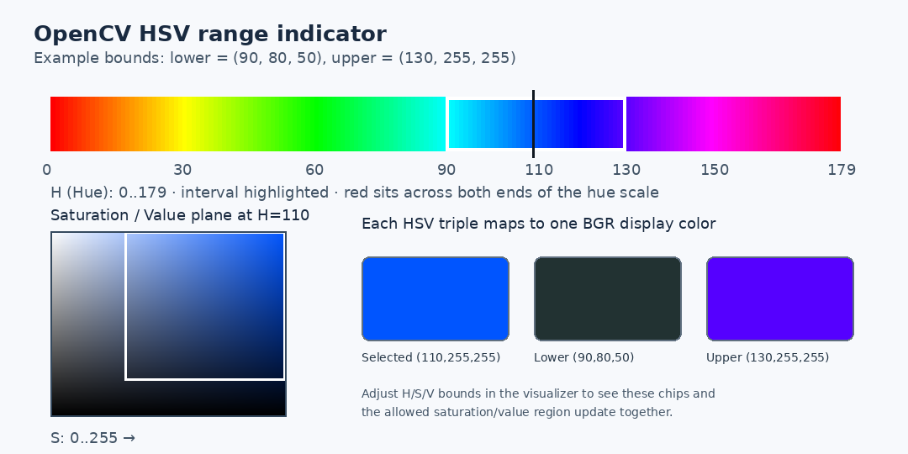
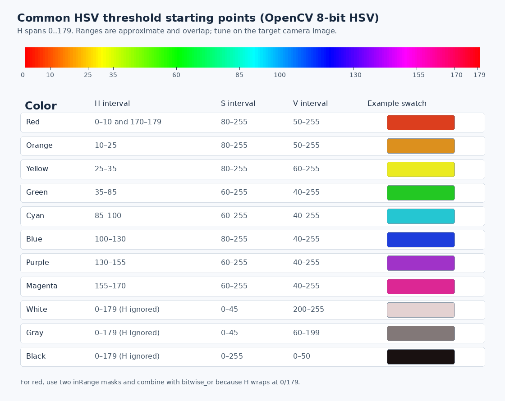
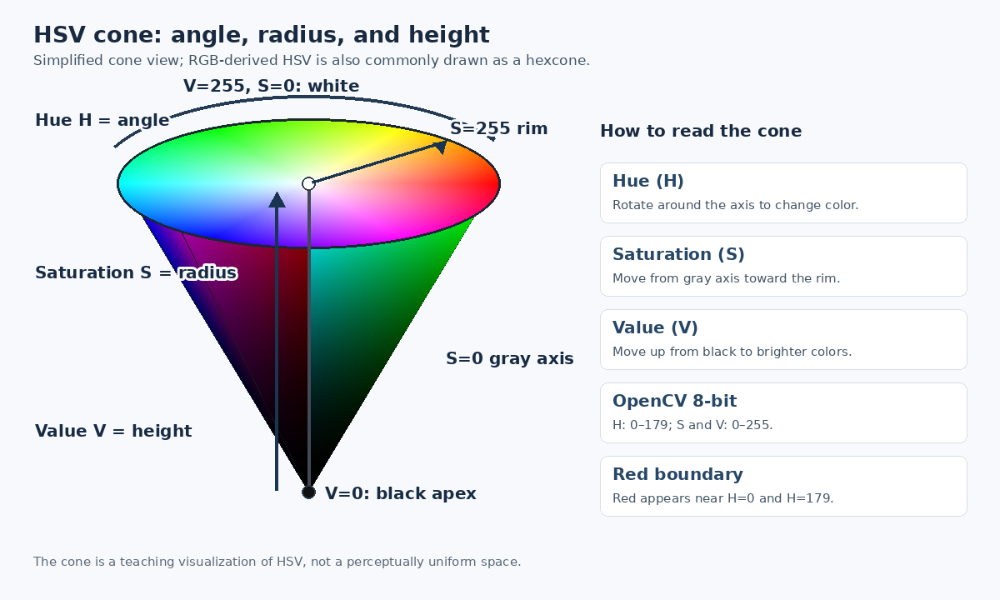

# 09｜HSV 色彩范围指示器



## 111

可调的版本做成一个独立 OpenCV HighGUI 小程序，布局放在 `src/hsv_range_visualizer/`，有自己的 `CMakeLists.txt`，不改项目根目录的 CMake 配置。

## 独立窗口功能

运行后会打开控制窗口和预览窗口：

- `Selected H/S/V`：选择一个具体 HSV 颜色；右侧色块显示转换到屏幕上的 BGR 颜色。
- `Lower H/S/V`、`Upper H/S/V`：拖动阈值上下界；下、上界色块和 HSV 色相带随数值更新。
- 左侧 S/V 平面固定当前 Selected H；横轴是饱和度 S，纵轴从 V=255 到 V=0。白框表示当前阈值在 S/V 平面上的有效区域，十字标记当前选定的 S/V。
- OpenCV 的 H 取值为 0–179，S/V 为 0–255。H 下界大于上界时表示跨越色相环末端和起点，常见于红色；真正对图像调用 `inRange` 时要分成两段掩模并用 `bitwise_or` 合并。S 或 V 下界大于上界则显示为无效范围。
- 按 `q` 或 `Esc` 关闭两个窗口。

## 单独编译和运行

在项目根目录执行：

```bash
cmake -S src/hsv_range_visualizer -B build-hsv
cmake --build build-hsv -j
./build-hsv/hsv_range_visualizer
```

这个 CMake 配置只查找 `core`、`imgproc`、`highgui`。如果 OpenCV 安装位置不在系统默认搜索路径，可显式提供配置文件目录，例如：

```bash
cmake -S src/hsv_range_visualizer -B build-hsv \
  -DOpenCV_DIR=/usr/lib/x86_64-linux-gnu/cmake/opencv4
```

程序需要桌面图形环境；无桌面的远程会话无法显示 HighGUI 窗口。

## 用滑块值设置颜色掩模

普通的连续 H 范围可直接传入 `inRange`：

```cpp
Scalar lower(hLow, sLow, vLow);
Scalar upper(hHigh, sHigh, vHigh);
inRange(hsvImage, lower, upper, mask);
```

红色跨过 H=179 与 H=0 时，要拆成两段：

```cpp
Mat redA, redB;
inRange(hsvImage, Scalar(hLow, sLow, vLow), Scalar(179, sHigh, vHigh), redA);
inRange(hsvImage, Scalar(0, sLow, vLow), Scalar(hHigh, sHigh, vHigh), redB);
bitwise_or(redA, redB, mask);
```

色块用于直观看单个 HSV 三元组对应的显示色；阈值范围本身是三维 HSV 盒状区域，不是一种唯一颜色。调整 S/V 上下界会改变被保留的颜色种类和亮度范围。

## 常用颜色范围参考

下面是一组 **调参起点**，不是固定标准值。OpenCV 的 8-bit HSV 中 H 范围为 0–179，S/V 为 0–255；`inRange` 对三个通道分别做上下界判断。相机白平衡、曝光、光源颜色和目标表面都会改变实测 HSV，建议在目标视频帧上用本页的滑块工具重新调节。[OpenCV `inRange` 教程](https://docs.opencv.org/4.x/da/d97/tutorial_threshold_inRange.html) 展示了 HSV 转换、滑块调阈值和 `inRange` 的调用方法。



表中 `H`、`S`、`V` 的上下界都是闭区间，顺序为 `(H, S, V)`。红色分为色相环两端的两段；其他色相区间允许相邻或轻微重叠，目的是留出边缘余量。

| 目标颜色 | Lower `(H,S,V)` | Upper `(H,S,V)` | 备注 |
|---|---:|---:|---|
| 红色（低 H 段） | `(0,80,50)` | `(10,255,255)` | 和高 H 段一起用 |
| 红色（高 H 段） | `(170,80,50)` | `(179,255,255)` | 与低 H 掩模 `bitwise_or` |
| 橙色 | `(10,80,50)` | `(25,255,255)` | 黄橙交界可微调 |
| 黄色 | `(25,80,60)` | `(35,255,255)` | 暗光下可降低 V 下限 |
| 绿色 | `(35,60,40)` | `(85,255,255)` | 范围较宽，按目标偏青/偏黄调 H |
| 青色 | `(85,60,40)` | `(100,255,255)` | 常与蓝、绿边缘相邻 |
| 蓝色 | `(100,80,40)` | `(130,255,255)` | 当前灯条代码用 `(90,80,50)` 到 `(130,255,255)` |
| 紫色 | `(130,60,40)` | `(155,255,255)` | 与蓝色、品红可能重叠 |
| 品红 | `(155,60,40)` | `(170,255,255)` | 红色高 H 段从约 170 开始 |
| 白色 | `(0,0,200)` | `(179,45,255)` | 低饱和、高亮度；H 实际不重要 |
| 灰色 | `(0,0,60)` | `(179,45,199)` | 低饱和、中等亮度 |
| 黑色 | `(0,0,0)` | `(179,255,50)` | 主要靠低 V 选择，彩色暗物体也会命中 |

示例代码：

```cpp
Mat mask;
// 普通单段颜色范围
inRange(hsv, Scalar(100, 80, 40), Scalar(130, 255, 255), mask); // 蓝色起点

// 红色需要拆成两段 H，再合并掩模
Mat redLow, redHigh;
inRange(hsv, Scalar(0, 80, 50), Scalar(10, 255, 255), redLow);
inRange(hsv, Scalar(170, 80, 50), Scalar(179, 255, 255), redHigh);
bitwise_or(redLow, redHigh, mask);
```

如果掩模漏掉目标，先观察目标像素的 H/S/V，再按原因逐项放宽：色相不匹配调 H，颜色发灰时降低 S 下限，暗部漏检时降低 V 下限。若背景被大量选中，则收窄造成误检的通道范围。一次不要同时大幅放宽 H/S/V，否则很难判断是哪项改变起作用。

## HSV 三维锥形示意图



图中把色相 H 画成绕中心轴的角度，饱和度 S 从灰度轴向外增加，明度 V 从黑色顶点向上增加。顶面表示 `V=255`，中心轴 `S=0` 是灰度；黑色顶点 `V=0` 时，色相与饱和度不再区分颜色。不同教材会把 HSV 画成圆锥或六角锥，这是对 HSV 坐标关系的几何示意。OpenCV 8-bit HSV 数值范围见上文；`cvtColor` 后的阈值仍应使用图像采样和 `inRange` 验证。

可参考 [普林斯顿大学计算机图形学课程的 HSV 圆锥图](https://www.cs.princeton.edu/courses/archive/spr17/cos426/notes/cos426_s17_lecture01_intro_color.pdf)；OpenCV 的 HSV 转换与阈值流程见 [官方 `inRange` 教程](https://docs.opencv.org/4.x/da/d97/tutorial_threshold_inRange.html)。
